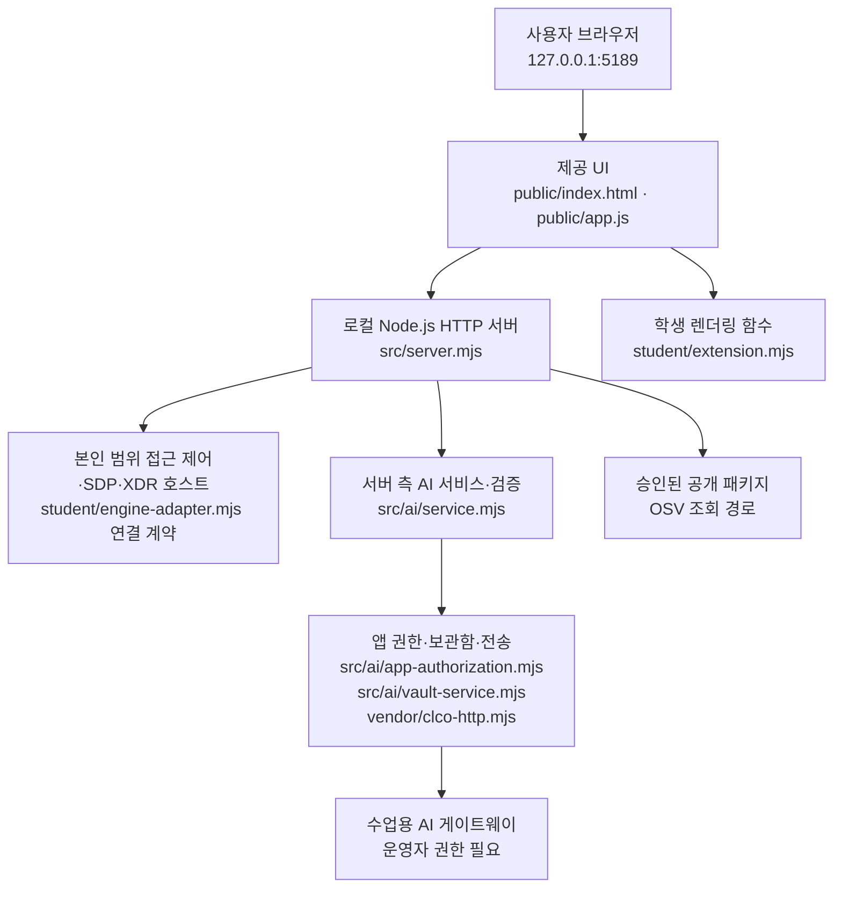

# 라일락 학생 실행 설명서 및 시스템 구성도 (21단계)

> 이 문서는 학생이 추가한 안내입니다. 기존 `README.md`, `docs/STUDENT_LAUNCH_GUIDE.md` 및 제공 앱의 소스·설정은 수정하지 않았습니다. 기록된 검증은 **GitHub 원문 대조**이며, 실제 PC 실행 성공을 의미하지 않습니다.

## 1. 목적과 현재 범위

**라일락**은 현재 로그인한 본인의 계정·기기·세션, 업무 앱 접근 판정, 최근 접속·XDR 기록, 상태·진단, AI 연결·설명, 조치 상태, 설치 패키지 OSV 조회 결과를 표시하는 학생용 보안 Agent입니다.

- 앱 자체는 Windows PowerShell과 Node.js를 사용하여 로컬 PC에서 실행합니다.
- 기본 실행은 연결되지 않은 상태이며, 예제 모드는 실제 SDP·AI 연결이 아닙니다.
- 보안 기록은 본인 범위의 최근 최대 40건입니다. XDR은 저장된 경보만 표시하며 새로 탐지하지 않습니다.
- 조치 집행은 기본 원천 연결이 지원되지 않으며, 학생 표시 함수는 조치 실행 API를 호출하지 않습니다.
- OSV에서 알려진 취약점이 없다는 결과는 안전 보장이 아닙니다.

## 2. 필요한 프로그램·버전 및 폴더

| 구분 | 원문에서 확인한 사실 | 실제 PC 확인 |
|---|---|---|
| Windows PowerShell | `tools/start-alekov.ps1` 제공 | 미확인 |
| Node.js | `package.json` engines: **24.19.0**; 실행 도구는 **22~24**를 허용, **24.19.0 권장** | 미확인 |
| npm | Node.js에서 사용; 외부 npm 의존성 없음, `npm start`, `npm run demo`, `npm run check` 스크립트 존재 | 미확인 |
| 브라우저 | 로컬 주소 `http://127.0.0.1:5189/` | 미확인 |
| Git / GitHub CLI | 저장소 복제·커밋·제출 시 사용 | 현재 PC 설치 버전 미확인 |
| 잠금 파일 | 이 저장소에서 `package-lock.json` 발견하지 못함 | 로컬 설치본 미확인 |

**현재 저장소:** `https://github.com/kjo35861/alekov-lilac-agent`

원래 제공 문서에서는 `on-client/`를 앱 폴더라고 부르지만, **별도 저장소를 만들면서 원래 `on-client/` 내부 파일을 새 저장소 루트에 배치했습니다.** 따라서 지금의 실제 명령 실행 위치는 **`package.json`, `src/`, `student/`, `tools/`, `public/`가 보이는 새 저장소 최상위 폴더**입니다. 기존 1~12단계 저장소와 별개이며, 그 저장소를 변경하지 않습니다.

```text
alekov-lilac-agent/            ← Git 루트이자 실행 폴더
├── package.json
├── .env.example               ← 비밀 없는 설정 예시
├── README.md                  ← 제공 문서(원본 유지)
├── student/
│   ├── extension.mjs          ← 13~20단계 학생 화면 구현
│   └── engine-adapter.mjs     ← 제공 엔진 연결 계약
├── public/
│   ├── index.html             ← 제공 화면
│   └── app.js                 ← 자료 조회·메뉴·학생 함수 연결
├── src/
│   ├── server.mjs             ← 로컬 HTTP 서버
│   └── ai/                    ← 앱 서버 측 AI 연결 및 검증
├── vendor/
│   └── clco-http.mjs          ← AI 게이트 전송 구현
├── tools/
│   └── start-alekov.ps1       ← 제공 실행 도구
└── docs/
    ├── STUDENT_LAUNCH_GUIDE.md
    ├── CONNECTION_TROUBLESHOOT.md
    └── STUDENT_RUNBOOK.md    ← 이 학생 문서
```

## 3. Windows PowerShell에서 실행·종료·재실행

아직 로컬 복제 폴더가 없다면 원하는 **새 빈 작업 상위 폴더**에서 다음을 실행합니다. 아래 `Downloads`는 작업 위치의 **예시**이며, 기존 사용자 PC 폴더를 실제 확인한 결과가 아닙니다.

```powershell
cd "$HOME\Downloads"
git clone https://github.com/kjo35861/alekov-lilac-agent.git
cd .\alekov-lilac-agent
Get-Location
Get-ChildItem package.json, .\src\server.mjs, .\tools\start-alekov.ps1
node --version
npm --version
npm run check
powershell -NoProfile -ExecutionPolicy Bypass -File .\tools\start-alekov.ps1
```

이미 복제한 폴더가 있다면 **다시 clone 하지 말고** 그 폴더에서 PowerShell을 엽니다. 파일 탐색기에서 실제 `package.json` 폴더의 주소창에 `powershell`을 입력해도 됩니다. `npm run check`는 `student/extension.mjs` **문법만 검사**하며 브라우저 동작이나 실제 AI 연결을 검증하지 않습니다. 별도 `npm install`은 `package.json`상 필수 외부 의존성이 없으므로 이 안내의 기본 실행 과정에 넣지 않았습니다.

서버 실행 후 브라우저에서 **http://127.0.0.1:5189/** 를 엽니다. 제공 실행 스크립트가 HTTP 200 응답을 확인하면 다음과 같이 안내하도록 작성되어 있습니다.

```text
케셰브가 켜졌습니다. 브라우저에서 http://127.0.0.1:5189/ 을 여세요.
서버가 응답한 것만 확인했습니다. AI 연결 상태는 화면에서 따로 확인해 주세요.
```

이는 제공 스크립트의 **원문 문구**이고, 개인 PC에서 실제 출력됐는지는 **미확인**입니다. 케셰브라는 문자열은 제공 앱 기본 명칭이며, 이 학생 Agent의 이름은 **라일락**입니다. 서버 HTTP 응답은 SDP 연결이나 AI 인증의 성공을 뜻하지 않습니다.

- **종료:** 앞의 실행 PowerShell에서 `Ctrl+C`.
- **재실행:** 같은 폴더에서 `powershell -NoProfile -ExecutionPolicy Bypass -File .\tools\start-alekov.ps1`.
- **대체 실행:** 같은 폴더에서 `npm start`. 예제 화면만 확인하려면 `npm run demo`; 실제 연결 아님.
- **포트 충돌:** `powershell -NoProfile -ExecutionPolicy Bypass -File .\tools\start-alekov.ps1 -Port 5190` 후 `http://127.0.0.1:5190/`. 다른 프로그램을 임의로 종료하지 않습니다.

## 4. 글로 쓴 시스템 구성도



**흐름 설명:** 브라우저의 `public/app.js`가 로컬 서버의 `/api/me`, `/api/devices`, `/api/sessions`, `/api/apps`, `/api/access`, `/api/events`, `/api/diagnostics`, `/api/vulnerabilities` 등 제공 API를 호출합니다. UI는 응답을 `student/extension.mjs`의 `createStudentView()`에서 반환한 표시 함수로 넘기고 새 DOM으로 학생 칸을 교체합니다. 학생 함수가 직접 SDP/AI/OSV 네트워크에 접속하지 않습니다.

SDP·XDR 실제 본인 조회는 운영자가 준비한 호스트 연결이 있어야 합니다. 앱 내 AI는 서버가 권한·모델 응답을 별도로 검증하고, 사건 설명 요청은 단순 모델 목록 점검과 다릅니다. 자동 조치 집행기가 연결된 것처럼 표현하지 않습니다.

## 5. 학생 구현과 제공 코드의 경계

| 함수/구성 | 역할 | 출처 |
|---|---|---|
| `renderIdentity` | 본인·기기·세션 상태 표시 | 학생, 13단계 |
| `renderDecision` | 앱 접근 판정·이유·시각 표시 | 학생, 14단계 |
| `renderEvents` | 최근 기록 필터·근거·규칙 상세, 미지원 안내 | 학생, 15~16단계 |
| `renderStatus` | 오류·알림·진단 정보·수동 복사 | 학생, 16단계 |
| `renderAiConnection` | AI 점검 및 인증·제한·취소 오류 구분 | 학생, 17단계 |
| `renderExplanation` | 선택 사건의 인용 근거·규칙·상태와 참고용 AI 설명 | 학생, 17~18단계 |
| `renderAction` | 준비·전송·ACK·효과 관측 구분; 직접 집행하지 않음 | 학생, 19단계 |
| `renderVulnerabilities` | 설치 버전과 OSV 결과·미조회·부분 실패 구분 | 학생, 20단계 |
| `public/app.js` | 세 메뉴, 데이터 요청·취소·새 렌더링·버튼 연결 | 제공 UI |
| `src/server.mjs`, `src/ai/`, `vendor/` | HTTP API, 서버측 정책·AI 검증과 외부 연결 | 제공 서버 코드 |
| `tools/start-alekov.ps1`, `.env.example` | 실행 검사와 비밀 없는 구성 견본 | 제공 파일 |

21단계에서는 화면 함수나 제공 코드를 추가·수정하지 않았습니다.

## 6. 실패 원인별 확인 순서

| 증상 | 확인할 것 | 안전한 다음 단계 |
|---|---|---|
| Node.js 없음·버전 불일치 | `node --version`; 제공 실행 도구의 22~24 허용 범위 | 수업 기준 24.19.0 설치 후 **새** PowerShell |
| `앱 폴더가 아닙니다` | `Get-Location`, `package.json` 위치 | 실제 새 저장소 루트에서 재실행 |
| 포트 5189 사용 중 | 스크립트의 포트 오류 문구 | `-Port 5190`으로 실행; 다른 앱 강제 종료 금지 |
| 서버 시작 시간 초과 | 시작 도구 출력, 서버 실행 상태 | 오류 메시지 보관·담당자 확인; 자동 재시도 없음 |
| 본인·기기·세션 조회 실패 | 화면의 `error.message`, `demo/disconnected/unknown` | 상단 **다시 불러오기** 수동 선택, 운영자 연결 상태 확인 |
| AI 권한 준비 중·인증/이용 제한 | 학생 AI 연결 상태의 안전한 `error.code` | 담당자에게 계정·앱 권한 확인; 키 입력·우회 금지 |
| AI 시간 초과·취소·네트워크 | 현 오류 코드, 취소 여부 | 필요시 사용자 직접 **현재 API 연결 점검**; 이전 결과 성공 간주 금지 |
| AI 설명 실패 | 선택 사건과 인용 근거, 앱 권한 | 기록은 유지; 실제 사건 설명 호출 성공은 별도 확인 |
| 설치 패키지 `not_configured/not_checked/unverifiable` | 승인된 공개 조회 범위, lock 메타데이터 | 운영자 설정 확인. 미조회를 '취약점 없음'으로 간주 금지 |
| 조치 `pending/unknown` | 요청·접수 ID와 관측 여부 | 지원 시 제공 **연동 시스템 결과만 재조회**; ACK를 효과로 단정하지 않음 |

오류 시 비밀번호·토큰·API 키·비공개 설정 파일을 첨부하거나 출력하지 않습니다. `.env.example`만 공개 가능한 예시이며 실제 비밀 설정은 Git 밖에 보관합니다.

## 7. 원문 검사로 확인한 것과 미확인 항목

**GitHub 원문으로 확인:** `package.json`의 스크립트/엔진 버전, 기본 주소와 HTTP 서버, 실행 도구의 포트·버전 점검·종료 안내, 제공 UI와 학생 렌더 함수의 연결, 13~20단계 학생 함수 코드의 존재, 서버측 AI 모듈 경로.

**확인하지 않음:** 학생 PC의 정확한 설치 Node/npm/Git 버전, 실제 PowerShell 시작·정상 종료, 브라우저의 마우스/키보드 동작, 실사용자 SDP 인증 및 업무 앱 판정, 저장된 XDR 이벤트 데이터, AI 게이트 권한 및 유료 사건 설명, 보안 조치 효과 확인, 실제 OSV 조회·정확한 설치 패키지 버전, `package-lock.json` 생성 여부, 공식 단계 통과. 이들을 실행 성공으로 적지 않습니다.

## 8. 코드 저장·제출 전에 할 일

- 기존 작업 폴더에서 `git status --short`로 다른 변경이 있는지 먼저 확인합니다. 문서 외 변경을 덮어쓰지 않습니다.
- 제출 대상은 **새 저장소의 최신 문서 커밋**이며, 21·22단계는 포털에 **저장소 주소와 40자리 커밋 해시를 직접 입력**합니다.
- 비공개 원문이 필요하면 과제 화면의 **「비공개 저장소 원문 준비 방법」**에서 최신 `student-source-cli.mjs`를 받아 **프로젝트 바깥**에 압축 해제하고, 결과 JSON도 **프로젝트 바깥**에 저장합니다. 실제 도구 명령·`--commit` 값은 포털 안내와 현재 Git HEAD를 확인한 뒤 입력합니다. 도구 원문 묶음 생성은 실제 기능 테스트나 공식 통과를 의미하지 않습니다.
- 공식 과제 제출 버튼은 사용자가 직접 누릅니다. 이 문서 작성은 제출을 실행하지 않습니다.
